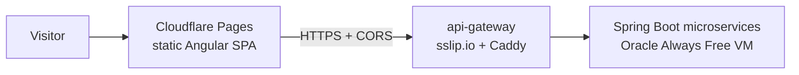

# Bazario

This project was generated using [Angular CLI](https://github.com/angular/angular-cli) version 21.2.2.

## Development server

To start a local development server, run:

```bash
ng serve
```

Once the server is running, open your browser and navigate to `http://localhost:4200/`. The application will automatically reload whenever you modify any of the source files.

## Code scaffolding

Angular CLI includes powerful code scaffolding tools. To generate a new component, run:

```bash
ng generate component component-name
```

For a complete list of available schematics (such as `components`, `directives`, or `pipes`), run:

```bash
ng generate --help
```

## Building

To build the project run:

```bash
ng build
```

This will compile your project and store the build artifacts in the `dist/` directory. By default, the production build optimizes your application for performance and speed.

## Running unit tests

To execute unit tests with the [Vitest](https://vitest.dev/) test runner, use the following command:

```bash
ng test
```

## Running end-to-end tests

For end-to-end (e2e) testing, run:

```bash
ng e2e
```

Angular CLI does not come with an end-to-end testing framework by default. You can choose one that suits your needs.

## Additional Resources

For more information on using the Angular CLI, including detailed command references, visit the [Angular CLI Overview and Command Reference](https://angular.dev/tools/cli) page.

## Live demo (FREE infrastructure)

- **Frontend:** `https://bazario.pages.dev` (Cloudflare Pages project: `bazario`)
- **Backend API:** `https://<VM-IP-WITH-DASHES>.sslip.io/api`
- **Demo login:** `demo@ecommerce.local` / `Demo@12345`

## Static SPA deployment (Cloudflare Pages)

The app includes `server.ts`, but SSR is **not required**: all data comes from
authenticated REST calls and tokens live in `localStorage`. Rendering on a Node
server would only produce a signed-out shell and Cloudflare Pages cannot run the
SSR server without extra workers. We therefore build a **static SPA**, which is
faster and free.

### Build settings (verified with the installed Angular 17.3 toolchain)

| Setting | Value |
|---------|-------|
| Cloudflare Pages project name | `bazario` (URL: `https://bazario.pages.dev`) |
| Build command | `npm run build:static` |
| Build output directory | `dist/ecommerce-platform/browser` |
| Root directory | `ecommerce-platform` (if deploying from a monorepo root) |
| Node version | 20 |
| Environment variable | `BACKEND_URL=https://<VM-IP-WITH-DASHES>.sslip.io` |

The real `angular.json` output path is `dist/ecommerce-platform`; the browser
bundle is in its `browser/` subfolder. `npm run build:static` runs
`scripts/generate-config.mjs`, which writes `environment.prod.ts` and
`public/_redirects` from `BACKEND_URL`, then builds with
`ng build --configuration production --prerender=false --ssr=false`.

### Steps

1. Push this repo to GitHub (branch `master`).
2. Cloudflare dashboard → **Workers & Pages** → **Create** → **Pages** →
   **Connect to Git** → select this repo → name the project `bazario` → **Begin setup**.
3. Framework preset **Angular**, build command and output directory as above.
4. Add environment variable `BACKEND_URL` = your HTTPS backend URL.
5. **Save and Deploy**. Every push to `master` redeploys automatically.

`public/_redirects` contains `/* /index.html 200` so Angular routes work on
refresh. CORS is configured **only** at the API gateway with your Pages URL.

### WebSocket note

Live notifications use SockJS through the gateway at
`${BACKEND_URL}/api/ws` (generated into `environment.wsUrl`). Local development
still uses `http://localhost:8086/ws`.

## Bazario architecture



